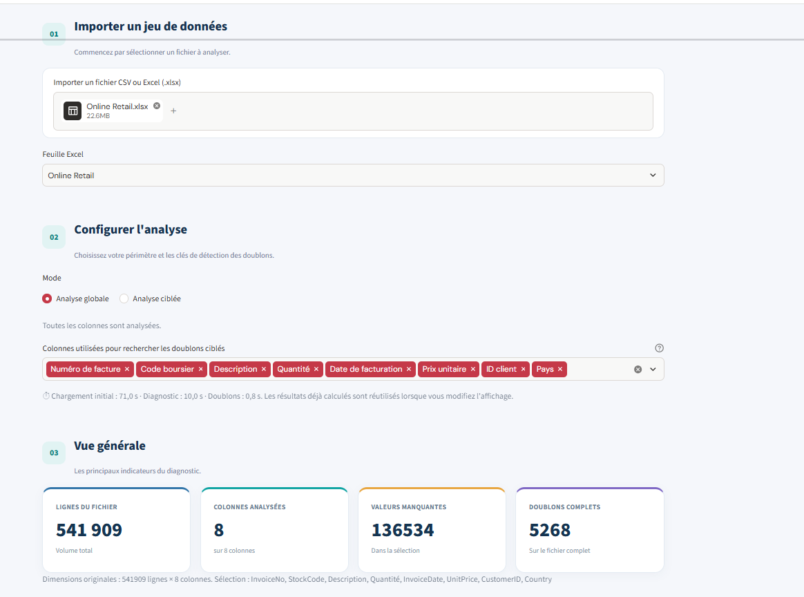
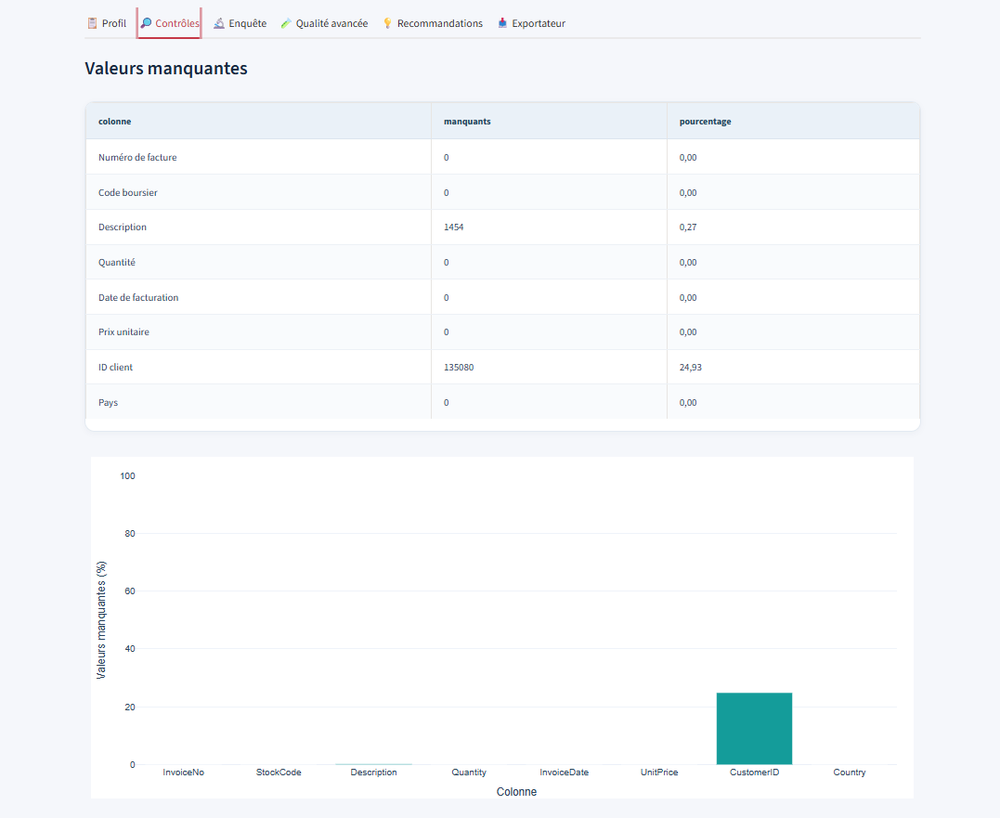
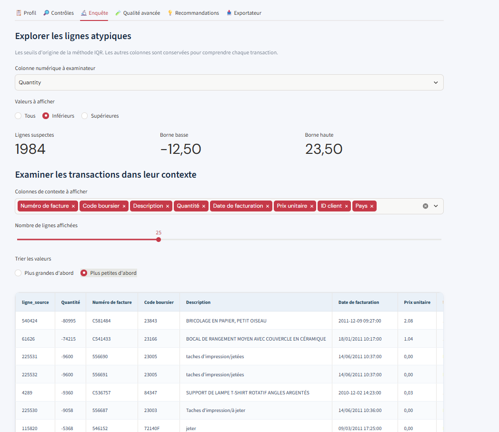

# Automated Data Quality Pipeline

**Application Python d'analyse exploratoire et de diagnostic de la qualité des données — Version 1.4**

Automated Data Quality Pipeline permet à un Data Analyst d'importer un fichier CSV ou Excel, de comprendre sa structure, de repérer les anomalies potentielles et de produire un rapport, sans avoir à réécrire les mêmes scripts pour chaque nouveau jeu de données.

Le principe de cette version est simple : **détecter, expliquer et documenter les anomalies, sans modifier automatiquement les données originales**.

## Problématique et objectifs

Avant de construire des indicateurs ou des tableaux de bord, un analyste doit s'assurer que ses données sont suffisamment fiables. Les fichiers reçus peuvent contenir des valeurs manquantes, des doublons, des formats incohérents ou des observations inhabituelles. Répéter manuellement ces contrôles prend du temps et augmente le risque d'oubli.

Ce projet vise à :

- automatiser les premières étapes d'exploration d'un dataset ;
- standardiser les contrôles de qualité sur des fichiers de structures différentes ;
- permettre une analyse globale ou ciblée sur certaines colonnes ;
- faciliter l'investigation des lignes suspectes ;
- fournir des recommandations explicables et des exports réutilisables.

## Fonctionnalités

| Module | Fonctionnalités |
| --- | --- |
| Importation | Fichiers `.csv` et `.xlsx`, sélection de feuille Excel, séparateur et encodage CSV |
| Profilage | Dimensions, types des colonnes, nombres de valeurs uniques, aperçu et statistiques descriptives |
| Qualité des données | Valeurs manquantes, chaînes vides, doublons complets ou sur colonnes-clés |
| Qualité avancée | Colonnes constantes ou quasi constantes, formats de dates et d'emails suspects, espaces parasites, variantes de casse, cardinalité élevée, valeurs négatives et zéros |
| Statistiques | Repérage des valeurs numériques atypiques avec la règle IQR |
| Investigation | Affichage des lignes atypiques dans leur contexte, tri et export CSV des observations filtrées |
| Recommandations | Conseils contextualisés, sans suppression ni remplacement automatique |
| Restitution | Interface Streamlit, graphiques Plotly, rapport HTML et récapitulatif CSV |

Les **colonnes à analyser** et les **colonnes-clés pour les doublons** sont sélectionnées indépendamment : les mesures par colonne respectent le périmètre choisi, tandis que la recherche des doublons porte sur le fichier complet.


## Aperçu de l'application

### 1. Tableau de bord général

Vue générale du jeu de données Online Retail avec
les indicateurs de qualité des données.



### 2. Contrôle de la qualité des données

Identification des valeurs manquantes et visualisation
de leur répartition par colonne.



### 3. Investigation des anomalies

Exploration des valeurs atypiques de la colonne Quantity
avec la méthode statistique IQR.



## Technologies utilisées

- **Python** : logique de traitement ;
- **Pandas** : lecture, exploration et contrôle des données ;
- **OpenPyXL** : lecture des classeurs Excel ;
- **Streamlit** : interface web locale ;
- **Plotly** : graphiques interactifs ;
- **Pytest** : tests automatisés ;
- **Git / GitHub** : suivi du code et publication.

## Architecture du projet

```text
automated-data-quality-pipeline/
├── app.py                       # Interface et orchestration Streamlit
├── requirements.txt             # Dépendances Python
├── README.md                    # Documentation
├── .gitignore                   # Fichiers exclus du suivi Git
├── data/
│   └── sample_data.csv          # Données fictives pour la démonstration
├── reports/                     # Répertoire réservé aux rapports
├── src/
│   ├── __init__.py
│   ├── file_loader.py           # Chargement CSV / Excel
│   ├── data_profiler.py         # Exploration et statistiques
│   ├── quality_checker.py       # Détection des anomalies
│   ├── recommendations.py       # Recommandations
│   ├── outlier_explorer.py      # Investigation des valeurs atypiques
│   └── report_generator.py      # Rapports HTML / CSV
└── tests/
    ├── test_file_loader.py
    ├── test_quality_checker.py
    ├── test_advanced_quality.py
    └── test_outlier_explorer.py
```

## Installation et lancement

### Prérequis

- Python compatible avec les versions indiquées dans `requirements.txt` ;
- Git (si vous souhaitez cloner le dépôt) ;
- un navigateur web moderne.

### Windows — PowerShell

```powershell
git clone https://github.com/geerangcharles-creator/automated-data-quality-pipeline.git
cd automated-data-quality-pipeline
py -m venv .venv
.\.venv\Scripts\python.exe -m pip install -r requirements.txt
.\.venv\Scripts\python.exe -m streamlit run app.py
```

La commande utilise directement le Python de `.venv` : l'activation des scripts PowerShell n'est pas nécessaire.

### Ubuntu / Linux

```bash
git clone https://github.com/geerangcharles-creator/automated-data-quality-pipeline.git
cd automated-data-quality-pipeline
python3 -m venv .venv
source .venv/bin/activate
python -m pip install -r requirements.txt
python -m streamlit run app.py
```

Ouvrez ensuite l'adresse affichée par Streamlit, généralement **http://localhost:8501**.

## Guide d'utilisation

1. Importez un fichier CSV ou Excel. Pour Excel, choisissez la feuille ; pour CSV, ajustez au besoin le séparateur ou l'encodage.
2. Choisissez le mode **Analyse globale** ou **Analyse ciblée**, puis les colonnes concernées.
3. Définissez séparément les colonnes-clés de détection des doublons.
4. Consultez le profil, les contrôles généraux et les contrôles de qualité avancés.
5. Dans **Investigation**, choisissez une colonne numérique présentant des valeurs atypiques, puis examinez les lignes correspondantes avec leurs informations de contexte.
6. Consultez les recommandations et téléchargez le rapport HTML, le récapitulatif CSV ou, si nécessaire, les lignes atypiques filtrées.

Pour une première utilisation, le fichier fictif `data/sample_data.csv` permet de découvrir toutes les étapes sans utiliser de données confidentielles.

## Exemple d'analyse : Online Retail

L'application a été testée avec le jeu de données public **Online Retail**, contenant **541 909 lignes et 8 colonnes**. Les résultats ci-dessous correspondent au fichier brut utilisé lors de notre validation :

| Contrôle | Résultat observé |
| --- | ---: |
| Valeurs manquantes — `CustomerID` | 135 080 |
| Valeurs manquantes — `Description` | 1 454 |
| Doublons complets supplémentaires | 5 268 |
| Quantités négatives — `Quantity` | 10 624 |
| Prix unitaires négatifs — `UnitPrice` | 2 |
| Prix unitaires nuls — `UnitPrice` | 2 515 |
| Quantités atypiques selon IQR | 58 619 |
| Prix atypiques selon IQR | 39 627 |

**Interprétation :** une observation atypique n'est pas forcément une erreur. Une quantité négative peut notamment correspondre à une annulation ou à un mouvement de stock. Les alertes doivent être confrontées aux règles métier avant toute correction.

### Méthode IQR

Pour une colonne numérique, l'écart interquartile est défini par `IQR = Q3 - Q1`. Les valeurs inférieures à `Q1 - 1,5 × IQR` ou supérieures à `Q3 + 1,5 × IQR` sont signalées. Cette méthode est indicative et n'est généralement pas pertinente pour les colonnes d'identifiants.

## Tests et fiabilité

Exécuter :

```bash
python -m pytest -v
```

**Résultat validé sous Windows : 18 tests réussis avec Python 3.13.12 et Pytest 9.2.0.**

La suite vérifie notamment l'importation, les fichiers vides, les valeurs manquantes, les doublons, les dates et formats suspects, les constantes, l'investigation IQR, les exports et la non-modification des données sources.

## Performances — V1.4

Pour limiter les ralentissements sur les fichiers volumineux, l'application :

- réutilise le fichier chargé pendant la session Streamlit ;
- conserve les diagnostics déjà calculés tant que les paramètres correspondants ne changent pas ;
- sépare le calcul des doublons des autres contrôles ;
- limite le nombre de lignes affichées dans l'aperçu d'investigation ;
- affiche les durées de chargement et de traitement.

Le premier chargement d'un classeur Excel volumineux reste plus coûteux qu'un changement de filtre. La mémoire utilisée dépend de la taille des données et du nombre de résultats conservés dans la session.

## Confidentialité et limites

- L'application n'applique **aucun nettoyage automatique** et n'écrase pas les fichiers importés.
- Les rapports HTML et CSV de synthèse contiennent principalement des statistiques, des noms de colonnes et des recommandations.
- **L'export CSV de l'onglet Investigation contient les lignes filtrées du dataset** : il peut inclure des identifiants ou des informations sensibles. Ne le publiez pas sans vérification.
- Les formats suspects sont détectés avec des règles génériques ; les formats spécifiques à une entreprise nécessitent des contrôles métier complémentaires.
- Les valeurs nulles, négatives, constantes ou atypiques sont des signaux d'analyse, pas des erreurs certaines.
- L'interface utilise des tableaux HTML pour rester compatible avec l'environnement Windows testé sans PyArrow ; sur des jeux de données volumineux, l'affichage reste volontairement limité.
- Le dossier `data/` est exclu du suivi Git, sauf `sample_data.csv`. Les autres fichiers et rapports réels ne doivent pas être ajoutés au dépôt public.

## Perspectives

- **V2** : nettoyage interactif avec confirmation, journal des modifications et comparaison avant/après ;
- **V3** : contrôles métier configurables et détection avancée des anomalies ;
- **V4** : analyse de plusieurs fichiers, historique et suivi de qualité dans le temps.

## Auteur

Projet personnel de Data Analyst, développé et documenté par **[geerangcharles-creator](https://github.com/geerangcharles-creator)**.

---

**Statut :** V1.4 publiée — diagnostic automatisé, investigation et restitution opérationnels.
